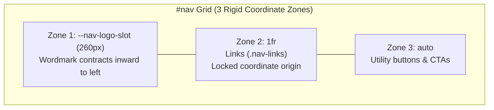

# Master Frontend Design & Editorial UI/UX Engineering

This skill dictates high-craft visual identity, production-level UI/UX architecture, color palette harmonization, cognitive ease, and motion constraints for all frontend code generated by Antigravity.

It unifies frontier design disciplines from **Anthropic** (Project Glasswing, Claude Academy, Claude Platform Docs), **Fuse.ai** (Editorial research maturity, tactile paper-and-ink materiality, participatory living artifacts), and **Google** (Material Design 3 HCT tonal color science, state layers, and spring kinematics).

---

## 1. Core Architectural Axioms (The Anti-Distraction Standard)

1. **Content & Context Over Chrome**: Navigation and chrome must be ambient and whisper-quiet. The user's cognitive bandwidth belongs 100% to reading, code comprehension, and artifact interaction—never wrestling with flashy UI noise.
2. **Easy on the Eye (Visual Ergonomics)**:
   - Zero high-frequency visual vibration or harsh pure `#000000` pitch blacks.
   - Grounded, warm, paper-and-ink or deep slate/zinc canvases.
   - Text contrast strictly satisfies WCAG AAA (contrast ratio $\ge 7:1$ for body prose, $\ge 4.5:1$ for large headings).
3. **The AI-Purple & Neon Gradient Ban [STRICT ENFORCEMENT]**:
   - The generic "AI Purple/Violet/Lila" neon gradient aesthetic is **categorically BANNED**.
   - Interfaces must draw from authentic physical media: editorial newsprint, warm terracotta, cactus/sage greens, deep obsidian slate, rich typographic charcoal, and single-hue electric cobalt accents.
4. **Anti-Emoji Policy in Production UI**:
   - Never use raw system emojis in headings, badges, tabs, or interface buttons.
   - Use clean monochrome vector icons (Phosphor, Radix, Lucide) with uniform `stroke-width: 1.5` and optical baseline centering.
5. **Zero Layout Shift Invariant (CLS = 0)**:
   - Navigation collapses, state toggles, and card transitions must **never** shift adjacent links or trigger horizontal reflows. Layout slots must be rigidly reserved.

---

## 2. Color Science & Palette Harmonization

### A. Dual Editorial Materiality (Dark & Paper Modes)

```css
:root {
  /* ── Dark Slate / Obsidian Base (Anthropic Glasswing + Google M3 Dark) ── */
  --canvas-base: #0a0d12;
  --surface-0: #0f141c;
  --surface-1: rgba(18, 24, 34, 0.75);
  --surface-2: rgba(28, 36, 50, 0.85);
  --surface-elevated: rgba(38, 48, 66, 0.9);
  
  --text-primary: #f3f4f6;
  --text-secondary: #9ca3af;
  --text-muted: #6b7280;
  
  --border-subtle: rgba(255, 255, 255, 0.08);
  --border-prominent: rgba(255, 255, 255, 0.16);
  --glass-specular: inset 0 1px 0 0 rgba(255, 255, 255, 0.08);

  /* ── Editorial Paper & Ink Base (Fuse.ai Research Mode) ── */
  --paper-ground: #f6f4ef;
  --paper-surface: #ffffff;
  --paper-subtle: #eae6de;
  --ink-primary: #141518;
  --ink-secondary: #4a4c52;
  --ink-muted: #7b7e87;
  --paper-border: rgba(20, 21, 24, 0.08);

  /* ── Single-Temperature Accent Families (Anthropic CDS / M3 HCT) ── */
  --accent-gold: #d4a85a;        /* Architectural Hardware / Monogram */
  --accent-cobalt: #2563eb;      /* Fuse.ai Electric Research Cobalt */
  --accent-cactus: #556862;      /* Claude Academy Sage/Cactus Fluency */
  --accent-peach: #d97757;       /* Claude Clay / Warm Terracotta */
  --accent-heather: #474654;     /* Deep Slate / Kernel Systems */
}
```

### B. Tactile Micro-Texture & Grain Overlay (Eliminating Digital Flatness)
To give editorial research pages authentic physical grain without performance overhead, use a hardware-accelerated SVG turbulence filter:
```html
<svg class="sr-only" aria-hidden="true">
  <filter id="editorial-grain">
    <feTurbulence type="fractalNoise" baseFrequency="0.8" numOctaves="3" stitchTiles="stitch" />
    <feColorMatrix type="matrix" values="0 0 0 0 0  0 0 0 0 0  0 0 0 0 0  0 0 0 0.035 0" />
  </filter>
</svg>
```
```css
.editorial-canvas::before {
  content: "";
  position: fixed;
  inset: 0;
  pointer-events: none;
  z-index: 999;
  filter: url(#editorial-grain);
  opacity: 0.6;
}
```

---

## 3. Typographic Hierarchy & Masked Motion Physics

### A. Expressive Font Pairing
* **Display / Editorial Headings**: `Geist`, `Cabinet Grotesk`, `Plus Jakarta Sans`, or `Playfair Display` (for formal research monographs).
  - Tracking: `letter-spacing: -0.025em` to `-0.035em` for high-impact editorial composure.
* **Prose Body**: High-legibility system or grotesque text stack (`Inter`, `Plus Jakarta Sans`). Max line length rigidly capped at `65ch` (`max-width: 65ch; line-height: 1.7;`).
* **Monospace / Metric Data**: `JetBrains Mono`, `DM Mono`, or `Fira Code` for badges, timestamps, hex commit hashes, and telemetry.

### B. Line-Masked Typographic Entrance Reveals (Fuse.ai Pattern)
Headings rise out of an invisible mask without jittering the document layout:
```html
<h1 class="mask-line">
  <span class="mask-line-inner">Exploring an Autonomous Future.</span>
</h1>
```
```css
.mask-line {
  overflow: hidden;
  display: block;
}
.mask-line-inner {
  display: inline-block;
  transform: translateY(100%);
  animation: mask-reveal 0.85s cubic-bezier(0.22, 1, 0.36, 1) forwards;
}
@keyframes mask-reveal {
  to { transform: translateY(0); }
}
```

### C. Calibrated Timing Curves (Google M3 + Kinetic Quintic)

| Token | Cubic Bezier Curve | Purpose |
| :--- | :--- | :--- |
| **Kinetic Quintic (Editorial)** | `cubic-bezier(0.22, 1, 0.36, 1)` | Headings, hero reveals, artifact expansion |
| **M3 Emphasized (Default)** | `cubic-bezier(0.2, 0.0, 0.0, 1.0)` | Modal dialogs, drawer panels, theme transitions |
| **M3 Emphasized Decelerate** | `cubic-bezier(0.05, 0.7, 0.1, 1.0)` | Incoming viewport cards, toast notifications |
| **Spring Snappy** | `cubic-bezier(0.16, 1, 0.3, 1)` | In-place wordmark collapses, hover lifts, squish |

---

## 4. Production-Level UI/UX Architecture & Navigation

### A. The In-Place Syllable Decomposition Wordmark (Project Glasswing Pattern)
**The Golden Invariant**: Never place a full brand name and its acronym side-by-side (`Full Name · ADT.`) only to vanish the full name. Decompose the wordmark into root initials and collapsible trailing syllables:

```html
<a href="/" class="nav-logo" aria-label="Aaradhya Dev Tamrakar">
  
  <span class="nav-brand-text" aria-hidden="true">
    <span class="nav-word"><span class="nav-initial">A</span><span class="nav-rest">aradhya</span></span>
    <span class="nav-word"><span class="nav-initial">D</span><span class="nav-rest">ev</span></span>
    <span class="nav-word"><span class="nav-initial">T</span><span class="nav-rest">amrakar</span></span>
    <span class="nav-dot">.</span>
  </span>
</a>
```

### B. Anti-Displacement 3-Zone Fixed-Slot Navigation Grid
When the wordmark collapses from $\sim 260\text{px}$ to $\sim 60\text{px}$, adjacent navigation links will violently shift leftward unless isolated by a dedicated grid slot:



```css
#nav {
  display: grid;
  grid-template-columns: var(--nav-logo-slot, 260px) 1fr auto;
  align-items: center;
}
.nav-rest {
  display: inline-block;
  max-width: 120px;
  opacity: 1;
  overflow: hidden;
  white-space: nowrap;
  vertical-align: bottom;
  transition:
    max-width 0.45s cubic-bezier(0.16, 1, 0.3, 1),
    opacity 0.3s cubic-bezier(0.16, 1, 0.3, 1),
    margin 0.35s cubic-bezier(0.16, 1, 0.3, 1);
}
#nav.scrolled .nav-rest {
  max-width: 0;
  opacity: 0;
  margin: 0;
}
```

### C. Pill-Style Ghost-Hover & Tactile Button Squish (Claude Platform Docs)
```css
.nav-links a {
  font-family: var(--mono);
  font-size: 0.78rem;
  letter-spacing: 0.1em;
  text-transform: uppercase;
  border-radius: 4px;
  padding: 0.5rem 0.85rem;
  transition: color 0.2s ease, background-color 0.25s cubic-bezier(0.16, 1, 0.3, 1);
}
.nav-links a:hover {
  background-color: var(--surface-1);
  color: var(--text-primary);
}
.nav-links a:active,
.btn-squish:active {
  transform: scale(0.96) !important;
}
```

---

## 5. Frontier Artifacts & Interactive Research Components

### A. Participatory Living Artifacts (Fuse.ai `voice-card[data-mine]` Pattern)
Instead of static project cards, flagship systems allow visitors, collaborators, or recruiters to interact and see instant participatory feedback:
```html
<div class="voice-card" data-mine="true">
  <div class="voice-blueprint-grid" aria-hidden="true"></div>
  <div class="voice-meta">
    <span class="badge-status">Active Invariant</span>
    <span class="voice-timestamp">Oct 18, 2026 · Verified Proof</span>
  </div>
  <h3 class="voice-title">Deterministic Agent Autonomy</h3>
  <p class="voice-body">All autonomous operations must pass strict pre-flight AST graphs and formal verification bounds.</p>
</div>
```
```css
.voice-card {
  position: relative;
  overflow: hidden;
  border: 1px solid var(--border-subtle);
  background: var(--surface-0);
  padding: 1.5rem;
  border-radius: 8px;
  transition: transform 0.25s cubic-bezier(0.16, 1, 0.3, 1), border-color 0.25s ease;
}
.voice-card[data-mine="true"] {
  border-color: var(--accent-cobalt);
  background: linear-gradient(135deg, var(--surface-0), rgba(37, 99, 235, 0.08));
  box-shadow: 0 8px 30px -10px rgba(37, 99, 235, 0.25);
}
.voice-blueprint-grid {
  position: absolute;
  inset: 0;
  pointer-events: none;
  opacity: 0.08;
  background-image: 
    linear-gradient(to right, currentColor 1px, transparent 1px),
    linear-gradient(to bottom, currentColor 1px, transparent 1px);
  background-size: 20px 20px;
}
```

### B. Horizontal Benchmark & Empirical Metrics (Glasswing Pattern)
Empirical metrics should use clean, horizontal comparison tracks with solid highlight fills and crosshatch baseline fills:
```html
<div class="gw-bar-group">
  <div class="gw-bar-header">
    <span class="gw-bar-title">Sensor Loop Latency (FreeRTOS DMA)</span>
    <span class="gw-bar-val">1.2ms (92% speedup)</span>
  </div>
  <div class="gw-bar-track">
    <div class="gw-bar-fill highlighted" style="width: 82%;"></div>
    <div class="gw-bar-fill crosshatch" style="width: 18%;"></div>
  </div>
</div>
```

### C. Hero Multi-Language Architecture & Code Runner (Claude Docs Pattern)
Multi-tab interactive code blocks in hero sections displaying actual production firmware and machine learning code:
* Tabs for: `C++ / ESP-IDF`, `Python / PyTorch`, `VHDL / Vivado`, `Verification CLI`.
* Direct "Copy to Clipboard" with tactile confirmation checkmark.
* Syntax-highlighted tokens honoring the single-accent temperature rules.

### D. Decorative SVG Mask Textures (Claude Academy Pattern)
Add geometric SVG mask patterns (`loops`, `strata`, `threads`) to card headers that gently scale on hover without shifting layout:
```css
.card-mask-loops::after {
  content: "";
  position: absolute;
  inset: 0;
  pointer-events: none;
  opacity: 0.08;
  background-color: var(--accent-cactus);
  -webkit-mask-image: radial-gradient(circle at 80% 20%, black 15%, transparent 60%),
    repeating-linear-gradient(45deg, black 0, black 2px, transparent 2px, transparent 10px);
  mask-image: radial-gradient(circle at 80% 20%, black 15%, transparent 60%),
    repeating-linear-gradient(45deg, black 0, black 2px, transparent 2px, transparent 10px);
  transition: opacity 0.35s ease, transform 0.4s ease;
}
.card-texture-wrap:hover .card-mask-loops::after {
  opacity: 0.16;
  transform: scale(1.05);
}
```

---

## 6. Accessibility, Performance & Verification Invariants

1. **Accessibility (`a11y`) Gate**:
   - `aria-label` declared on all brand anchors while visual syllable decompositions retain `aria-hidden="true"`.
   - All interactive controls have visible focus rings (`focus-visible: outline 2px solid var(--accent)`).
2. **Reduced Motion**:
   - Enforce zero duration and immediate translations inside `@media (prefers-reduced-motion: reduce)`:
     ```css
     @media (prefers-reduced-motion: reduce) {
       *, *::before, *::after {
         animation-duration: 0.01ms !important;
         animation-iteration-count: 1 !important;
         transition-duration: 0.01ms !important;
         scroll-behavior: auto !important;
       }
     }
     ```
3. **Responsive Containment**:
   - Explicitly collapse or hide complex secondary wordmarks below `900px` viewports to protect mobile navigation space.
4. **Deterministic Verification**:
   - Every interface change must pass local linters (`ruff`, `eslint`) and verification suites (`python scripts/verify.py` or equivalent test harness) with 100% clean passes before commits.
