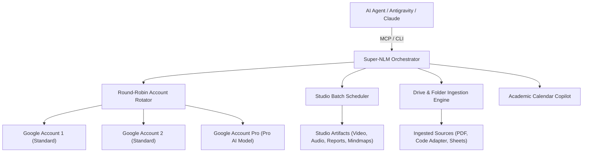

# Super-NLM Orchestrator & Fleet Management Skill

This skill provides comprehensive instructions for operating **Super-NLM**, a multi-account unified orchestrator and Model Context Protocol (MCP) server for Google NotebookLM.

---

## 1. Architectural Overview

Super-NLM enables parallel AI agents and developers to interact with $N$ Google NotebookLM accounts without hitting single-account query quotas or rate limits.



### Core Engine Capabilities
1. **Round-Robin Multi-Account Rotation**: Distributes notebook queries evenly across registered accounts.
2. **Two-Tiered Rate Limiting & Cooldown**:
   - **Burst Concurrency (429 / RPM)**: 120-second cooldown while token bucket refills.
   - **Daily Quota Exhaustion (RPD)**: Automatic cooldown until 00:00 UTC midnight.
   - **Automatic Fallback**: Pending queries immediately retry on the next available account.
3. **Studio Artifact Generation & Bulk Downloads**: Batch generation of video overviews, audio deep-dives, reports, mind maps, quizzes, and flashcards with deduplicated downloads.
4. **Hybrid Folder Mapping & Drive Sync**: Ingests local files or Google Drive web folders with automatic code adapters (`.ipynb` markdown extraction, `.py`, `.c`, `.m`, `.xlsx`).
5. **Academic Calendar & Course Copilot**: Auto-matches upcoming syllabus exams/deadlines to course codes (`CT653`, `CT704`, `EX751`, `EX752`, `ME708`, `EX725`).

---

## 2. Model Context Protocol (MCP) Reference

When `super-nlm` MCP server is active, use the following tools:

### Querying & Synthesis
- **`query_notebook(notebook_id, query, conversation_id?, source_ids?, timeout?, new_conversation?, use_pro?)`**:
  Query a notebook with automatic fleet rotation and optional Pro AI routing (`use_pro=True`).
- **`cross_query(notebook_ids[], query, synthesizer_profile_id?)`**:
  Query across multiple notebooks in parallel and synthesize unified insights using Pro AI.
- **`list_notebooks(search?, profile_id?, category?)`**:
  Search and list notebooks from local cache without consuming API quota (`category`: `'study'`, `'projects'`, or `'all'`).
- **`list_profiles()`**:
  List all connected Google profiles, their tiers (`pro` vs `standard`), and status.
- **`rotation_status()`**:
  Check fleet diagnostics, active query cooldowns, and round-robin counter.

### Studio Artifact Operations & Scheduling
- **`schedule_batch_creation(notebook_ids[], artifact_type, format_option?, style?, custom_prompt?, quantity?, difficulty?, preferred_profile_id?)`**:
  Queue background studio artifact creation across multiple notebooks.
  - `artifact_type`: `'video'`, `'audio'`, `'quiz'`, `'flashcards'`, `'mind_map'`, `'report'`, `'infographic'`, `'data_table'`, `'slide_deck'`.
- **`get_scheduled_queue(status_filter?)`**:
  Inspect queue items (`pending`, `running`, `completed`, `failed`).
- **`cancel_scheduled_job(job_id)`**:
  Cancel an active or queued generation task.

### Fleet operations

#### Hub notebook and Fleet batch controls

The notebook grid shows at most **8 notebooks per page** with a visible range/total counter (for example, `1–8/51`); selections persist while paging. Each card identifies the creator account from verified owner-role metadata. Shared collaborators appear as colored account dots plus `+N`; pending invitations are visually faded. `+?` means sharing metadata is unknown, not that the notebook is unshared. Sync to refresh metadata and never infer ownership from the profile used to query the notebook. Press **F** to open Fleet Batches, **Esc** to close it, and `?` to view the shortcut reference. The selected-notebook **Batch Download** action opens Fleet Batches with those IDs prefilled for review.


`download_mode="auto"` starts at one transfer and probes up to six using completed transfer windows (bytes / elapsed time, including CLI/server overhead). It backs off after failures or absent throughput gains, ignores tiny/incomplete samples for tuning, and shows observed MiB/s plus concurrency. This is a heuristic, not an internet line-speed test. Manual concurrency remains available. Paused batches can select Auto on resume.

Notebooks download sequentially in input order. `artifact_concurrency` controls simultaneous artifacts within the current notebook (1-6, default 1 for slow connections). The GUI offers sequential or parallel modes; a paused batch can change concurrency when resumed.

Clean filenames use the artifact title and extension (for example `Evolution of Context.mp4`). Add a short ID suffix only for name collisions; keep full IDs in the local catalog and batch manifests. Recognize and safely rename legacy type/title/UUID filenames without re-downloading. The scheduler also uses the actual artifact title when available.

Downloads always use the `default` account; generation retains fleet rotation. The download CLI has no `--profile` option: set `NLM_PROFILE=default` only in the child process environment, removing inherited `NOTEBOOKLM_COOKIES`. Never switch the saved CLI default for each download.


- Use the Hub **Fleet batch** dialog to paste notebook URLs/UUIDs or include selected, filtered, or all notebooks. Download all Studio artifacts by default, optionally filter types, preview per-notebook folders, and choose an external destination.
- `get_notebook_share_status(notebook_id, profile_id?)` reads collaborators, roles and pending invitations without sharing. Unlisted accounts remain unknown. `list_notebook_sources` returns IDs/titles; `preflight_studio_generation(notebook_ids, exclude_sources?)` checks access and scope without creation.
- `schedule_batch_creation` accepts `source_ids`, `source_ids_by_notebook`, `exclude_sources`, `prompts`, and `request_key`. Notebooks multiply by prompts; `{notebook_title}` expands titles. Source exclusions can include `seed.sql`. Browser source checkboxes are not read. Explicit source IDs are validated and passed to creation.
- `pause_scheduler_dispatch` retains submitted work; `resume_scheduler_dispatch` resumes new submissions. `cleanup_scheduled_jobs(statuses?, batch_id?)` deletes terminal history only. Retry existing jobs with `run_scheduled_job_now`.
- `batch_download_artifacts(notebook_ids, artifact_types?, output_root?, notebook_folders?, skip_existing?, request_key?)` starts persistent bulk downloads. Omit types for all supported types: video, audio, report, quiz, flashcards, mindmap, slides, infographic, data-table.
- Inspect with `get_download_batch(batch_id)` / `list_download_batches()`. `resume_download_batch` retries/re-scans without generation; `pause_download_batch` pauses a locally owned batch. `download_batch_results(batch_id, output_root?)` restricts downloads to exact IDs from a generation batch.
- Output paths are on the Super-NLM host, outside repositories. Default scheduler output is `~/Downloads/Super-NLM/Generated`. Bulk batches export manifests; nonempty files indexed by artifact ID are skipped. Keep the same request key for retrying an identical submission; changed settings require a new key.
- OS leases enforce one scheduler writer. MCP forwards queue controls to the owning Hub at loopback `SUPER_NLM_HUB_URL` (default port 8000), with its configured access key. Download batch/profile/folder leases coordinate processes.
- Accepted artifact IDs persist before polling; restart resumes those IDs. Legacy interrupted jobs without IDs fail for inspection rather than automatic regeneration. Finish old-worker generations before upgrading/restarting Hub and MCP, since old workers ignore the new leases.
- Errors retain stage, notebook, profile, exit code, stdout/stderr and provider details. A generic upstream source error marks the cause unavailable; do not invent an explanation. Sharing status alone does not prove generation permission or remaining quota.
- Automated coverage uses isolated storage and mocked CLI calls. Fleet throughput and provider quotas have not been benchmarked.

### Folder Mapping & Ingestion
- **`map_notebook_folder(notebook_id, target_path, folder_type?, display_name?, auto_sync?, recursive?)`**:
  Map a local filesystem path or Google Drive folder URL/ID to a notebook.
- **`get_folder_status(notebook_id)`**:
  Inspect mapped folder diffs (new, ingested, stale, unsupported) and 300-source capacity meter.
- **`sync_notebook_folder(notebook_id, action?, selected_files?)`**:
  Trigger sequential, rate-limited ingestion of new or stale sources.

### Calendar & Sharing
- **`get_agenda(days?)`**:
  Fetch upcoming schedule matched against registered course notebooks.
- **`batch_share_notebooks(notebook_ids[], target_profile_ids?, role?, auto_sync?)`**:
  Share notebooks across accounts with automatic editor permission caching.
- **`auto_share_study_courses(role?, auto_sync?)`**:
  Auto-detect all academic course notebooks and share across the fleet.

---

## 3. Direct CLI Workflows (`nlm`)

The `nlm` unified CLI can be executed directly for high-throughput batch operations:

### Studio Artifact Downloads & LocalSend Sharing
For automated URL resolution, folder routing outside the repo, and LocalSend transfers, activate the companion skill **`super-nlm-downloads`**:
```powershell
node C:\Users\Aaradhya\.gemini\config\skills\super-nlm-downloads\scripts\download_and_share.mjs "<notebook_url_or_id>" [--share] [--files-only] [--to "V2029"]
```
> [!IMPORTANT]
> **Zero Repo Pollution Rule**: Never download or stage artifacts inside the repository working tree. Always route to subject folders directly under `C:\Users\Aaradhya\Downloads\<Subject> Exam`.

To download manually into a subject folder without duplicates:
```powershell
nlm download all <notebook_id> --output-dir "C:\Users\Aaradhya\Downloads\<Subject> Exam" --skip-existing --interactive-format markdown
```

To download specific artifact types:
```powershell
# Download video overviews
nlm download video <notebook_id> --id <artifact_id> --output "video_title.mp4"

# Download reports/study guides
nlm download report <notebook_id> --id <artifact_id> --output "report_title.md"

# Download mind maps
nlm download mind-map <notebook_id> --id <artifact_id> --output "mindmap_title.json"
```

### Inspecting Studio Status
```powershell
nlm studio status <notebook_id> --json
```

---


## 4. Academic Course Mappings & Notebook IDs

For reference, the primary course notebooks in the ecosystem include:

| Course Code | Subject / Notebook Title | Key Notebook ID |
|---|---|---|
| **ME708** | ME708 - Organization and Management | `94cd4e14-802d-4231-b27d-6a4f4a2e6182` |
| **CT653** | Artificial Intelligence | `0e89a8...` |
| **CT704** | Digital Signal Analysis and Processing | `e52d46...` |
| **EX751** | Energy Management & Audit | *Fleet Managed* |
| **EX752** | RF & Microwave Engineering | `EX752...` |
| **EX725** | Embedded Systems Design | *Fleet Managed* |
| **Personal** | ⚙️ Aaradhya — Engineer's Personal Notebook | `95a79d26-2f87-42cd-8cb9-8361a1e56059` |
| **SPARK** | SPARK Research | `2c00f5a4-98dc-4783-96d1-3682fa3cb516` |
| **BiasAperture** | BiasAperture Study | `99bee3c6-07ed-4ff0-8ac8-0027b18ad06a` |

---

## 5. Ingestion Rules & Adapters

When preparing source files for ingestion via Super-NLM:
- **Direct Gemini Notebook folder preparation**: Check the current official supported-source list. Keep supported originals in their native format and create a Markdown copy only for a source type that Gemini Notebook does not accept. Preserve the original beside the copy; do not convert an entire folder or create redundant Markdown copies for supported PDFs, Office documents, Google Workspace files, images, audio, or video. This rule applies to Drive folders prepared for direct Notebook ingestion; Super-NLM's own adapters below may transform inputs within its separate ingestion flow.
- **Jupyter Notebooks (`.ipynb`)**: Never ingested raw. Super-NLM's code adapter converts markdown cells and executable code blocks into clean markdown text before uploading.
- **Source Code (`.py`, `.c`, `.cpp`, `.m`, `.ts`, `.js`, `.json`, `.sql`)**: Wrapped in code fences with syntax headers.
- **Spreadsheets (`.xlsx`, `.xls`)**: Transformed into structured CSV / Markdown data tables.
- **Unsupported Executables / Archives (`.zip`, `.exe`, `.dll`, `.iso`)**: Automatically filtered out by the ingestion scanner.
- **Capacity Gates**: Ingestion verifies target capacity (Standard: 50 sources, Pro AI: 300 sources) before triggering batch uploads.
